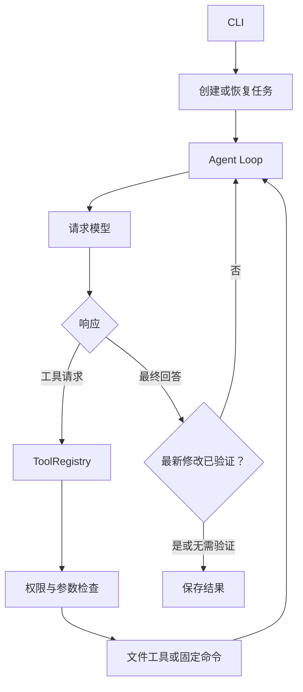
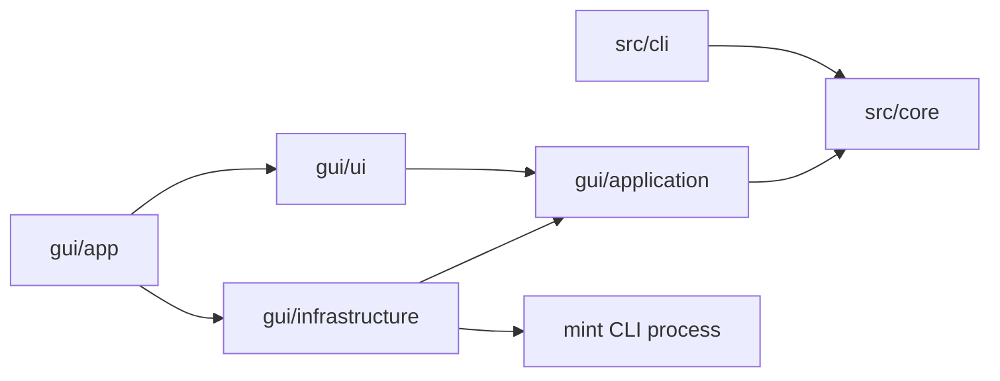
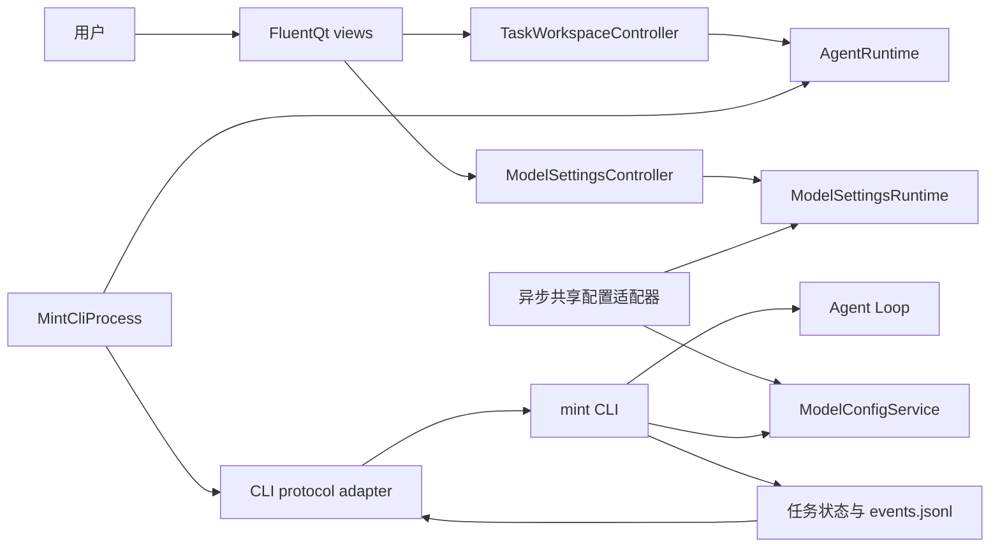

# 架构

[← 返回文档树](../../README.md)

mint 把模型判断和本地执行分开：模型只能返回文字或工具请求，文件和进程操作全部由本地代码完成。

## 一次任务



每轮都会保存 checkpoint。模型直接回答且没有待验证修改时，任务只需要一次请求；Agent Loop 不是固定轮数的工作流。

## 源码结构

源码先按产品边界分成三块：

```text
src/
├── core/   Agent、工具、模型、存储、安全与本地化
├── cli/    命令行入口和参数适配
└── gui/    桌面用例、CLI 进程适配、FluentQt 界面和启动入口
```

`core` 不依赖 CLI、Qt 或 FluentQt。CLI 只组装 `core`。GUI 通过类型化端口启动 `mint` CLI，不复制 Agent Loop，也不在界面层解析 JSON。

三块内部再按职责拆分：

```text
src/core/
├── application/     Agent Loop、checkpoint 和项目用例
├── domain/          policy、限制、模型数据和变更记录
├── tools/           工具注册、工作区访问和变更事务
├── infrastructure/  模型、命令、存储、日志和文件系统实现
├── localization/    类型化中英文消息目录
└── runtime/         路径、取消、审批和终端规则

include/mint/
└── ports/           模型、工具、会话、事件和取消接口

src/cli/
├── agent/       任务运行与事件路由
├── config/      共享模型配置的查询、保存与迁移
├── project/     init、resume、status 的项目状态
├── provider/    配置检查与真实握手
├── support/     终端与诊断日志适配
├── command_line.*
└── main.cpp

src/gui/
├── application/     不依赖 Qt 的桌面状态、用例、偏好与模型设置端口
├── infrastructure/  CLI 进程、JSON 协议、QSettings 和共享配置异步适配
├── ui/              FluentQt 页面、组件、模型和主题
└── app/             只负责组装依赖和启动窗口
```

目录边界也是 CMake target 和自动化测试边界。

`ports` 只有公共头文件，因此直接由 `src/core/CMakeLists.txt` 声明为
`mint::ports` 接口目标，不保留没有实现文件的 `src/core/ports` 目录。



桌面界面不链接或复制 Agent Loop，也不解析 JSON。`TaskWorkspaceController` 通过 `MintCliProcess` 维护任务状态；`ModelSettingsController` 通过异步共享配置适配器维护公开的模型信息，不再单独管理配置文件或向 CLI 注入密钥：

控制器分别保存执行任务快照与当前浏览会话。运行事件只更新所属任务，切换工作区不改变执行权限或审批归属。CLI 适配器在后台分批读取、解析事件日志，界面模型增量接收；进程结束后先排空尾日志，再发布结构化终态。可恢复的非零退出码仍是任务结果；进程崩溃与缺失结果会提供独立错误说明。

启动入口先确定本次设置目录，再读取其中的工作区目录和上次选中项。显式 `--root` 优先；未指定时仅恢复有效历史路径，不把 GUI 进程的当前目录当作项目。工作区目录不从其他 QSettings 组织或系统域回退读取；没有有效工作区时保留空导航状态，直到用户选择文件夹。



`src/gui/app/gui_main.cpp` 是桌面组合根。语言、主题、工作区目录和任务置顶、归档状态仍交给 QSettings；模型配置不再属于 GUI 偏好。`core/infrastructure/settings/ModelConfigService` 是 GUI、CLI 唯一的模型文件读写入口，统一负责校验、旧配置迁移、私有文件权限、跨进程锁、版本冲突和原子提交。`model.json` 保存公开配置与不透明密钥引用，`credentials.json` 保存 endpoint/协议绑定的密钥。

GUI 的设置适配器在后台线程调用同一个服务，并监听外部修改；未保存草稿不会静默覆盖新版本。保存未完成或旧配置迁移尚未解决时，控制器拒绝新的真实模型执行，浏览和正在运行的任务不受影响。CLI 的 `config` 命令直接调用服务，任务启动时只读取配置快照，不承担迁移。默认不发现或导入工作区中的 `config.json`；已有共享配置时，旧文件的替换导入必须明确指定并通过版本检查。GUI 升级保留原先明确选择的配置来源，成功导入或用户明确解决冲突后才清除旧指针，不会静默改用另一默认模型。显式 `--config` 是单次覆盖，不更新共享默认值；GUI 保存成功会清除该窗口的覆盖并采用共享配置。密钥不会进入 UI 状态、普通偏好、模型消息、工具子进程或命令参数。models.dev 目录仍未接入。

`tests/cmake` 中的架构契约会检查依赖方向、终端输出边界和模块目录，防止实现重新堆回聚合文件夹。

## 模型适配

Agent 只认识 `ModelClient` 和统一的 `ModelReply`。供应商配置先解析为 `ProviderProfile`，再由 adapter 生成请求并解析响应：

```text
ModelConfigService → ProviderProfile → protocol adapter → HTTP/SSE → ModelReply
```

现有 adapter 和供应商配置见[模型配置](../reference/model-providers.md)。接入同协议的新服务通常只需增加模板和 profile；只有 wire format 不兼容时才增加 adapter。

## 工具边界

`ToolRegistry` 实现 `AgentTools`，但工具协议和实现分开：

- `registry` 定义稳定工具名、参数 Schema 和路由；
- `workspace` 负责路径解析和文件操作；
- `changes` 负责审计、事务和恢复；
- 命令执行委托给 `core/infrastructure` 的 `CommandRunner`。

公开头文件只暴露任务需要的接口和配置。实现细节留在 `src`，新增工具不应让 application 依赖具体文件系统或进程类型。

## 本地状态

| 文件 | 内容 |
|---|---|
| `session.json` | 模型上下文、checkpoint 和最终结果 |
| `events.jsonl` | 工具、审批和验证事件 |
| `policy.json` | 文件、命令和资源权限 |
| `logs/mint-*.jsonl` | 不含正文的运行诊断 |

托管任务状态位于工作区之外。安全边界和恢复规则见[安全与恢复](../guides/safety-and-recovery.md)。
