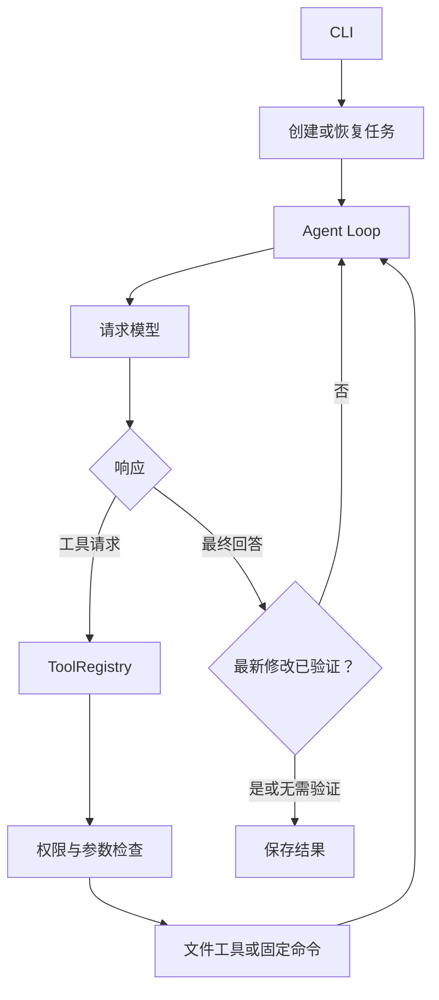
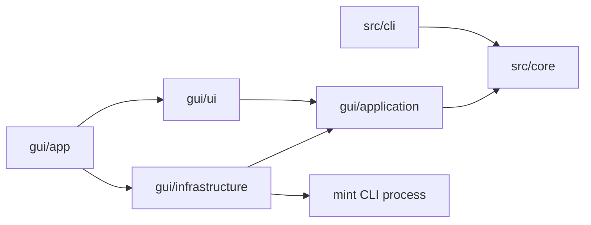

# 架构

[← 返回文档树](../../README.md)

mint 把模型判断和本地执行分开：模型只能返回文字或工具请求，文件和进程操作全部由本地代码完成。

## 一次任务



每轮都会保存 checkpoint。模型直接回答且没有待验证修改时，任务只需要一次请求；Agent Loop 不是固定轮数的工作流。

## 源码结构

源码先按产品边界分成三块：

```text
src/
├── core/   Agent、工具、模型、存储、安全与本地化
├── cli/    命令行入口和参数适配
└── gui/    桌面用例、CLI 进程适配、FluentQt 界面和启动入口
```

`core` 不依赖 CLI、Qt 或 FluentQt。CLI 只组装 `core`。GUI 通过类型化端口启动 `mint` CLI，不复制 Agent Loop，也不在界面层解析 JSON。

三块内部再按职责拆分：

```text
src/core/
├── application/     Agent Loop、checkpoint 和项目用例
├── domain/          policy、限制、模型数据和变更记录
├── tools/           工具注册、工作区访问和变更事务
├── infrastructure/  模型、命令、存储、日志和文件系统实现
├── localization/    类型化中英文消息目录
├── platform/        路径编码、时间、系统目录和底层文件操作
└── runtime/         路径、取消、审批和终端规则

include/mint/
├── ports/           模型、工具、会话、事件和取消接口
└── platform/        只使用标准库类型的平台能力入口

src/cli/
├── agent/       任务运行与事件路由
├── config/      共享模型配置的查询、保存与迁移
├── project/     init、resume、status 的项目状态
├── provider/    配置检查与真实握手
├── support/     终端与诊断日志适配
├── platform/    原生进程入口与 Windows 参数编码
├── command_line.*
└── main.cpp

src/gui/
├── application/     不依赖 Qt 的桌面状态、用例、偏好与模型设置端口
├── infrastructure/  CLI 进程、JSON 协议、QSettings 和共享配置异步适配
├── ui/              FluentQt 页面、组件、模型和主题
├── support/         Qt 与标准路径类型的转换
└── app/             只负责组装依赖和启动窗口
```

目录边界也是 CMake target 和自动化测试边界。

Agent 的运行接口是 `ModelClient`、`AgentTools`、`SessionRepository`、`AgentEventSink` 和 `StopToken`。`core/application/agent` 不直接链接模型客户端或工具实现；CLI 负责组装，`mint::core` 则为嵌入者聚合各功能库。

`domain` 目前包含策略加载，`project_service` 也会读取项目标识文件，部分领域代码仍涉及 I/O。



桌面运行状态由 `TaskRun` 保存，`TaskWorkspaceController` 负责导航和当前视图。切换工作区不会改变运行任务、审批归属或执行权限。CLI 适配器通过 `RunEventStream` 分批读取事件，进程结束后先排空日志，再发布结果。

模型配置只有一个持久化入口 `ModelConfigService`，内部按参数解析、凭据绑定和存储事务分开。CLI 直接调用服务；GUI 的适配器负责异步调度和外部修改通知，同步存储操作不持有界面对象。保存使用版本检查，正在运行的任务保留启动时的配置快照。覆盖与迁移规则见[模型配置](../reference/model-providers.md)。

工作区、主题等界面偏好保存在 QSettings，与模型配置和密钥分开。GUI 启动优先采用显式 `--root`，否则恢复有效的历史选择；没有有效目录时显示空导航。

平台差异按能力收敛：通用操作调用 `mint::platform`，命令启动和私有目录权限分别由 `command/native`、`filesystem/native` 实现。CMake 选择各系统的后端；业务代码和公共头文件不包含平台条件编译或系统 SDK 类型。`platform` 不依赖领域模型、Qt 或本地化，权限决策和用户错误仍由调用模块负责。

`tests/cmake` 中的架构契约会检查依赖方向、平台边界、终端输出和模块目录。

## 模型适配

Agent 只认识 `ModelClient` 和统一的 `ModelReply`。供应商配置先解析为 `ProviderProfile`，再由 adapter 生成请求并解析响应：

```text
ModelConfigService → ProviderProfile → protocol adapter → HTTP/SSE → ModelReply
```

现有 adapter 和供应商配置见[模型配置](../reference/model-providers.md)。接入同协议的新服务通常只需增加模板和 profile；只有 wire format 不兼容时才增加 adapter。

## 工具边界

`ToolRegistry` 实现 `AgentTools`，但工具协议和实现分开：

- `registry` 定义稳定工具名、参数 Schema 和路由；
- `workspace` 负责路径解析和文件操作；
- `changes` 负责审计、事务和恢复；
- 命令执行委托给 `core/infrastructure` 的 `CommandRunner`。

公开头文件只暴露任务需要的接口和配置。实现细节留在 `src`，新增工具不应让 application 依赖具体文件系统或进程类型。

## 本地状态

| 文件 | 内容 |
|---|---|
| `session.json` | 模型上下文、checkpoint 和最终结果 |
| `events.jsonl` | 工具、审批和验证事件 |
| `policy.json` | 文件、命令和资源权限 |
| `logs/mint-*.jsonl` | 不含正文的运行诊断 |

托管任务状态位于工作区之外。安全边界和恢复规则见[安全与恢复](../guides/safety-and-recovery.md)。

## 读码顺序

| 顺序 | 文件 | 先看什么 |
|---|---|---|
| 1 | [CLI main](../../src/cli/main.cpp) → [agent_command](../../src/cli/agent/agent_command.cpp) | 参数如何变成一次任务 |
| 2 | [Agent 公共接口](../../include/mint/application/agent.hpp) → [agent_loop](../../src/core/application/agent/agent_loop.cpp) | 何时请求模型、执行工具和结束运行 |
| 3 | [ports](../../include/mint/ports) → [agent_cycle](../../src/core/application/agent/agent_cycle.cpp) | Agent 怎样调用模型、工具和状态存储接口 |
| 4 | [tool_registry](../../src/core/tools/registry/tool_registry.cpp) → [workspace 工具](../../src/core/tools/workspace) | 工具请求怎样校验和执行 |
| 5 | [model_client](../../src/core/infrastructure/model/model_client.cpp) → [协议分发](../../src/core/infrastructure/model/model_protocol.cpp) | 模型接口怎样转换各协议的请求与响应 |
| 6 | [model_config_service](../../src/core/infrastructure/settings/model_config_service.cpp) | GUI / CLI 怎样共享设置和密钥 |
| 7 | [gui_main](../../src/gui/app/gui_main.cpp) → [任务页面](../../src/gui/ui/pages/task_workspace_page.cpp) → [控制器](../../src/gui/application/task_workspace_controller.cpp) | 窗口、状态与后台任务怎样连接 |
| 8 | [platform 文件入口](../../include/mint/platform/file.hpp) → [命令 native 后端](../../src/core/infrastructure/command/native) | 系统差异的公共接口和各平台实现 |

完整的目录与文件说明见[源码导读](../guide/README.md)。
